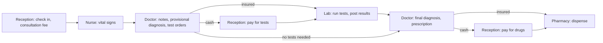

# Advanced Database Systems Portfolio: Tomiwa Hospitals

MIT 8103 Advanced Database Systems · 2026/2027 First Semester Continuous Assessment

## Portfolios

| Folder | Activity | Main evidence |
|---|---|---|
| [portfolio-1-database-design](portfolio-1-database-design/) | Database design and modelling | Chen and logical ER diagrams, normalisation to BCNF, a 24-table PostgreSQL schema loaded with 21.9 million rows of synthetic data |
| [portfolio-2-query-optimisation](portfolio-2-query-optimisation/) | Query processing and optimisation | Execution plans before and after seven indexes and a materialised view, query rewrites, and the cost of the indexes |
| [portfolio-3-transactions-concurrency](portfolio-3-transactions-concurrency/) | Transactions and concurrency | Commit, rollback and savepoints, isolation anomalies and their fixes, write skew, deadlock, and crash recovery |
| [portfolio-4-nosql](portfolio-4-nosql/) | NoSQL and advanced data models | The same hospital as MongoDB documents, with validation, indexes, transactions and cross-checks against PostgreSQL |
| [portfolio-5-distributed-cloud](portfolio-5-distributed-cloud/) | Distributed and cloud databases | A three-member replica set under failure, shard key analysis, two-phase commit, and cloud deployment under the NDPA |

## Running it

The only requirement is Docker Desktop. Copy `.env.example` to `.env`, set a password, and start the containers:

```powershell
docker compose up -d
```

This starts PostgreSQL 16 (`hospital-postgres`) and three MongoDB 8.0 servers (`hospital-mongo`, `hospital-mongo-2` and `hospital-mongo-3`). The repository is mounted read-only in each container at `/portfolio`. Each portfolio's README lists the commands to run, and the portfolios build on each other, so run them in order. Portfolio 4 starts the MongoDB replica set and Portfolio 5 adds the other two members.

## Case study: Tomiwa Hospitals

Tomiwa Hospitals is a simulated private hospital group, used as the single case study for all five portfolio activities in this repository. It is not a real organisation, and every record in the database is synthetic.

### The organisation

Tomiwa Hospitals began as a single outpatient hospital in Ilorin, Kwara State. Strong patient demand and outside investment have since grown it to branches in 16 of Nigeria's 36 states, and the group plans to open in the remaining 20. Each branch runs a general outpatient service with its own reception, nurses' station, consulting rooms, laboratory and pharmacy, and sees about 200 patients a day. Across the group that is roughly 3,200 visits a day, or about 1.17 million a year.

A patient registers once and can then be seen at any branch. A patient who registered in Ilorin keeps the same record when they visit the Lagos branch, and the doctor there can see their full history.

### Users of the database

| Role | Looks up | Records |
|---|---|---|
| Receptionist | Patient records, the day's appointments, outstanding charges | New patient accounts, check-ins for walk-in and booked patients, payments from cash patients |
| Nurse | The patient checked in for the visit | Vital signs such as temperature, blood pressure, pulse and weight |
| Doctor | Vitals, past visits and lab results, on the doctor's portal | Symptoms, clinical notes, provisional and final diagnoses, lab test orders, prescriptions |
| Lab scientist | Test orders that are paid for or covered by insurance | Test results |
| Pharmacist | Prescriptions ready to dispense | Drugs dispensed |
| Head of Pharmacy | The branch's drug stock levels | Stock adjustments, restock requests |
| Branch Manager | Restock requests and branch activity | Approval or rejection of restock requests |
| Patient, on the portal | Their own appointments, diagnoses, results and prescriptions | Appointment bookings |

### A typical visit

The visit is the centre of the system. Everything that happens to a patient on one trip to the hospital, from check-in to collecting their drugs, is recorded against a single visit record.

1. **Reception.** The patient checks in, as a walk-in or for a booked appointment, and the consultation fee is charged. A new patient has an account opened first.
2. **Nurses' station.** A nurse records the patient's vital signs.
3. **Consultation.** The doctor reviews the vitals and the patient's history, records symptoms, notes and a provisional diagnosis, and orders any lab tests needed, such as a malaria parasite (MP) test, full blood count (FBC), microscopy or urinalysis.
4. **Payment for tests.** Cash patients return to reception to pay for the tests.
5. **Laboratory.** The order is already in the lab's queue when the patient arrives. A lab scientist runs the tests and posts the results.
6. **Review.** The patient returns to the doctor, who reviews the results, records the final diagnosis and writes a prescription.
7. **Payment for drugs.** Cash patients pay for the prescribed drugs at reception.
8. **Pharmacy.** The pharmacist looks up the prescription and dispenses the drugs, which reduces the branch's stock.

Patients insured through a Health Maintenance Organisation (HMO) skip steps 4 and 7. Their charges are still recorded against the visit but are billed to the insurer instead of being paid at the counter. When no tests are needed, the doctor records the final diagnosis and prescribes during the first consultation, and steps 4 to 6 are skipped.



### Major data

- **Branches**, with the state each one is in
- **Patients**, with personal and contact details
- **Insurers** (HMOs), and each patient's insurance cover with the dates it is valid
- **Staff**, with their role and branch
- **Appointments**, booked at reception or on the portal
- **Visits**, recording the branch, patient, check-in time, whether it was a walk-in or an appointment, and how it is being paid for
- **Vital signs** taken at each visit
- **Symptoms and clinical notes**
- **Diagnoses**, provisional and final, each with the doctor who made it and when
- **Lab tests** offered and their prices, with **lab orders** and their **results**
- **Drugs** and their prices, with **prescriptions** and the drugs on each
- **Branch drug stock** and **restock requests**
- **Charges and payments**

### Key operations

- Register a new patient, and find an existing patient from any branch
- Book an appointment, at reception or on the portal, without double-booking a doctor
- Check a patient in and charge the consultation fee
- Record vital signs
- Record symptoms, notes and diagnoses
- Order lab tests, and show the lab its queue of tests that are paid for or covered by insurance
- Record lab results
- Write prescriptions
- Take payments from cash patients, and record charges billed to insurers
- Dispense drugs and reduce the branch's stock in the same step
- Raise and approve restock requests when stock runs low
- Show staff a patient's full history, and show patients their own records on the portal

### Scope and assumptions

- Outpatient care only. Admissions, wards and surgery are out of scope.
- Only drug stock is tracked. Laboratory reagents and other supplies are out of scope.
- Drug stock and dispensing are counted in the smallest unit, such as a tablet, bottle or vial.
- Each lab measurement has one adult normal range. Ranges that vary by age or sex are out of scope.
- Charges for insured patients are recorded and marked as billed to their HMO. Processing the claim with the HMO is out of scope.
- Clinical records are never overwritten. A final diagnosis is added alongside the provisional one rather than replacing it.
- Prices and insurance cover are recorded as they stood at the time of the visit, so later changes do not alter past bills.
- The patient portal shows diagnoses, lab results and prescriptions, but not doctors' clinical notes.
- All data is synthetic. No real patient data is used, in line with the Nigeria Data Protection Act (NDPA) 2023.
