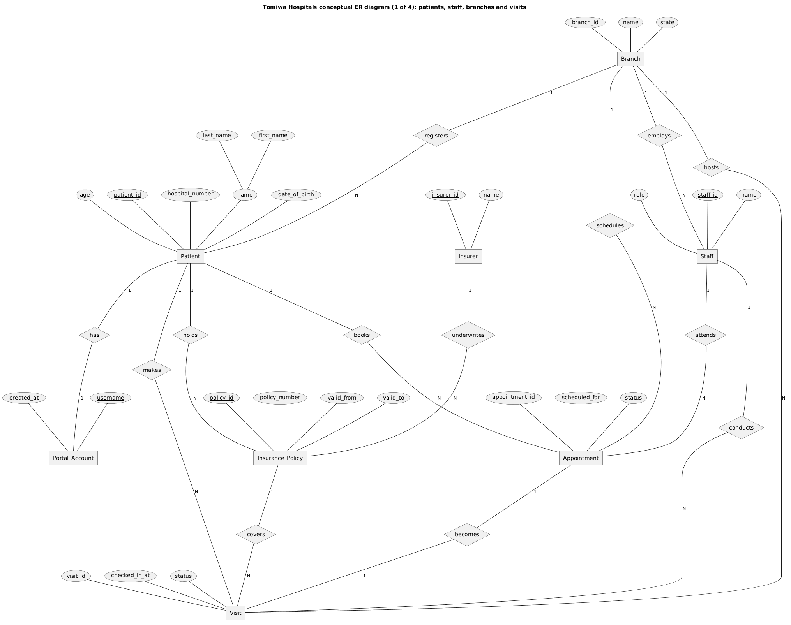
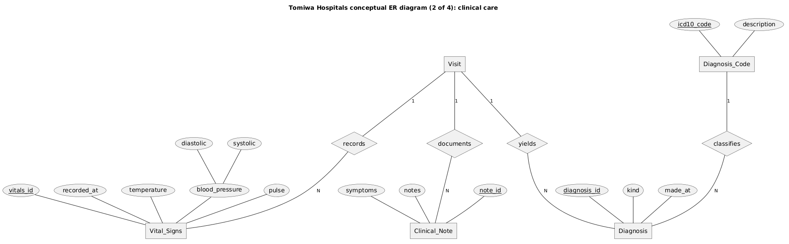
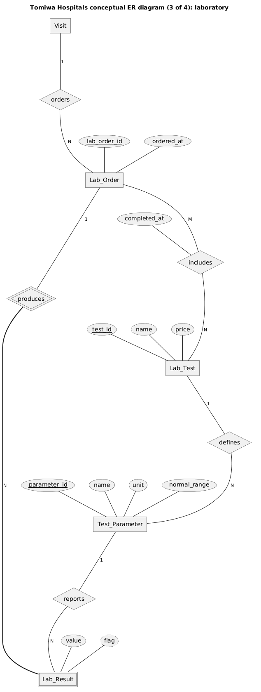
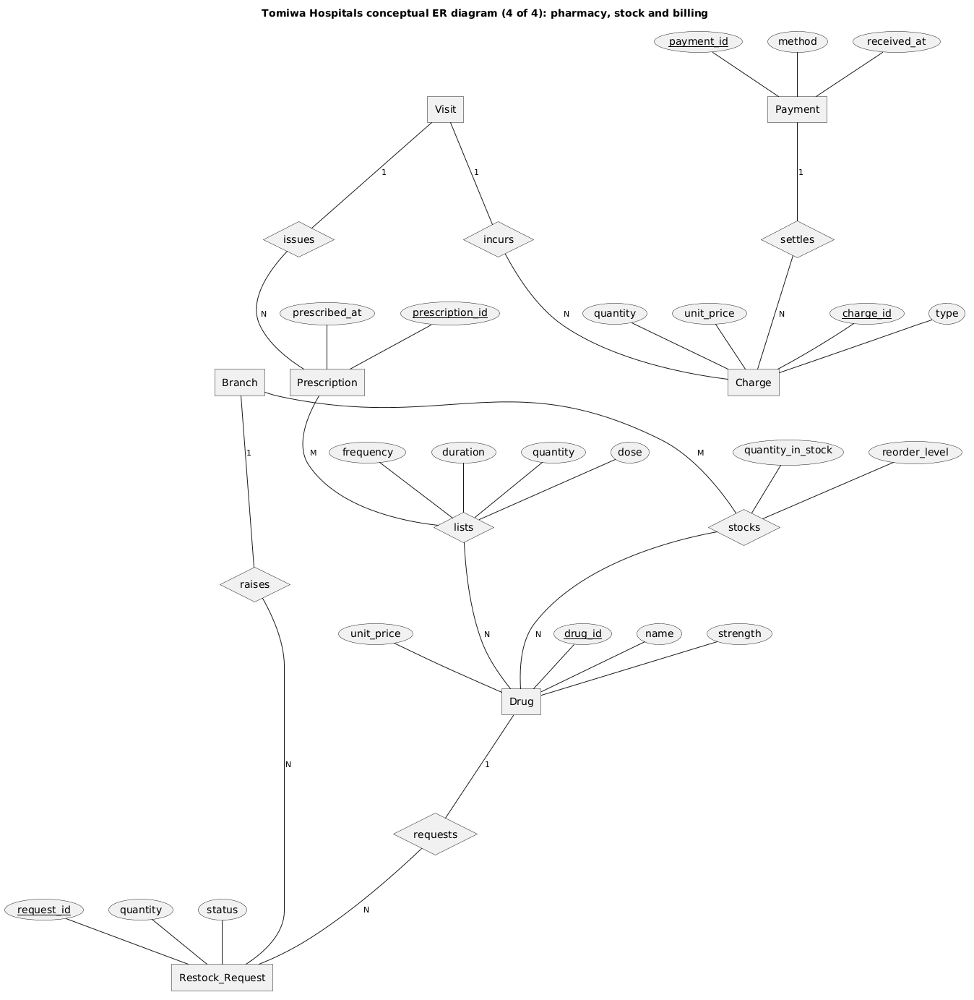
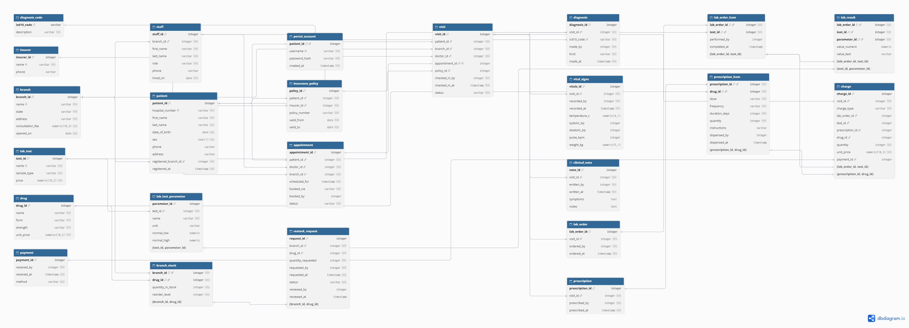
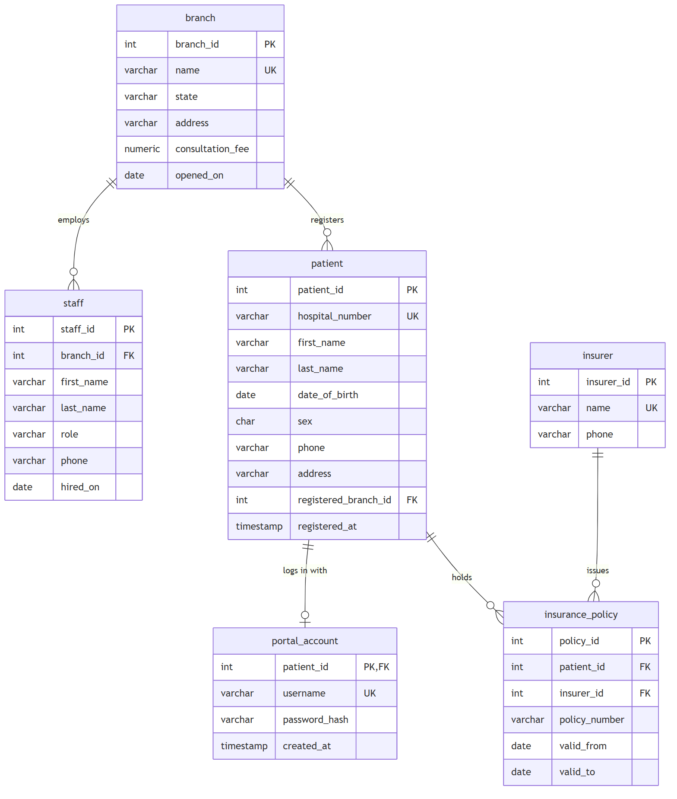
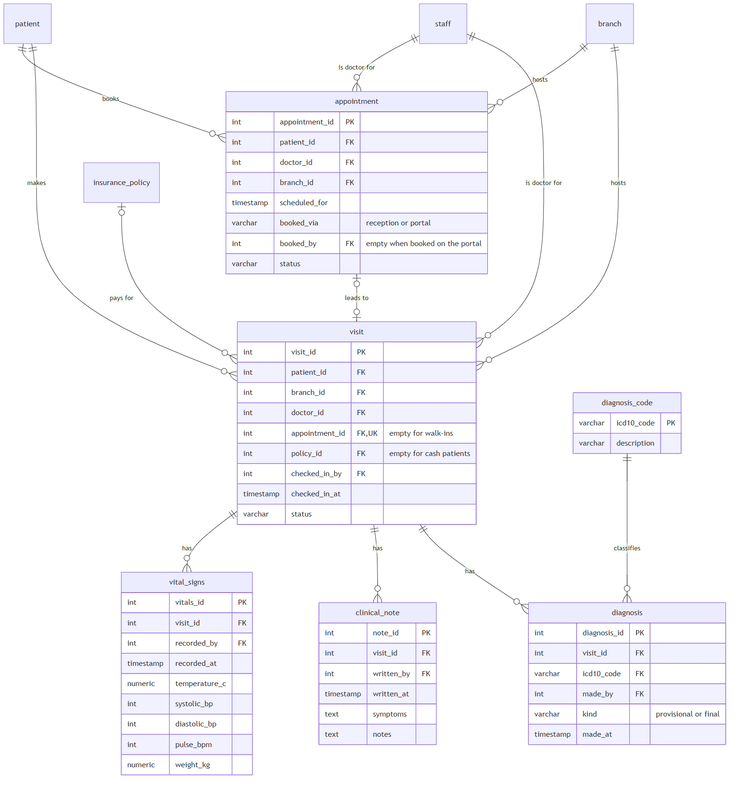
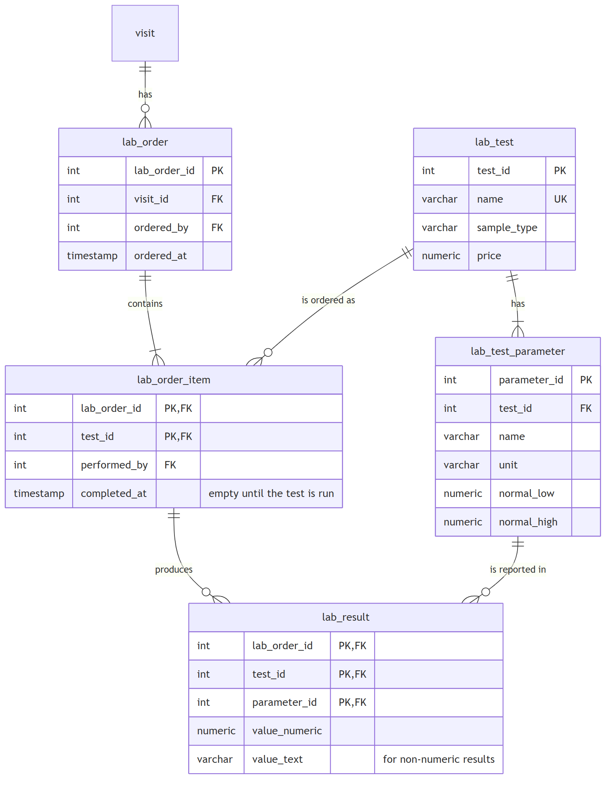
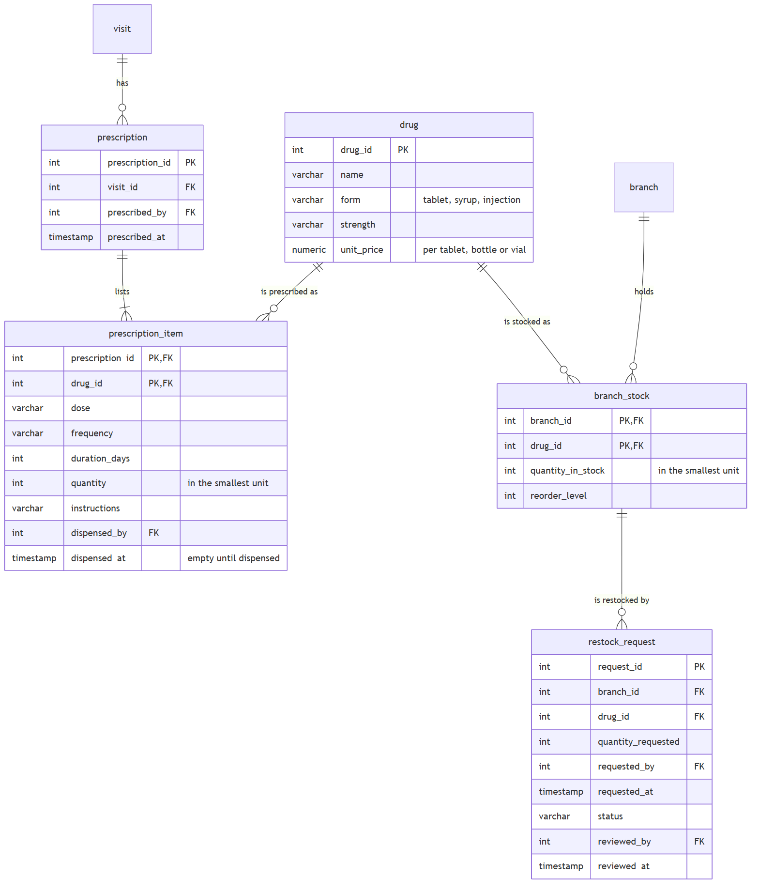
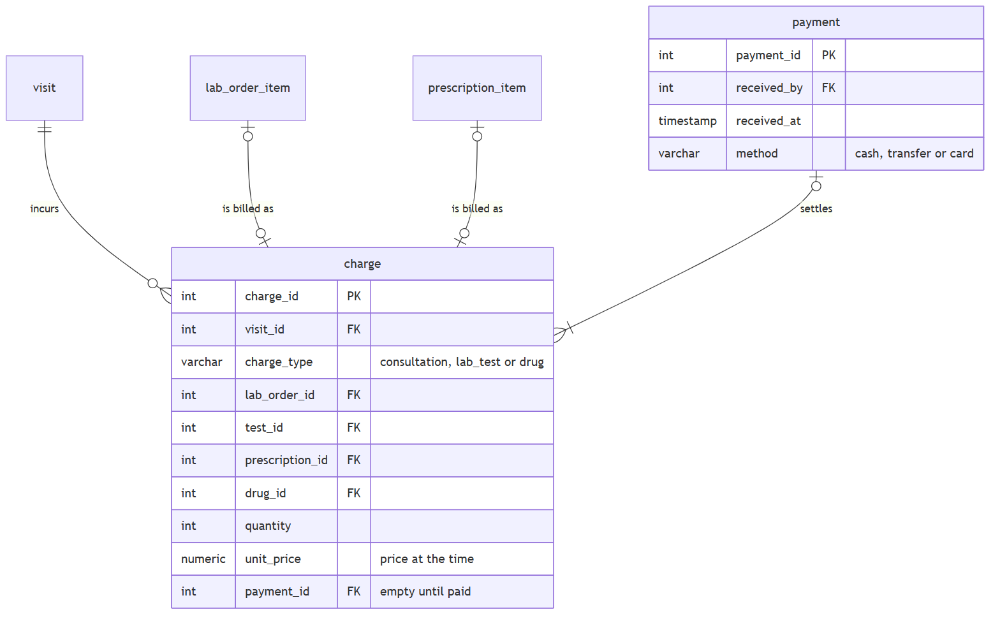

# Portfolio 1: Database Design and Modelling

Case study: **Tomiwa Hospitals** (see the [main README](../README.md)).

The design moves through the stages described in the course material: a **conceptual** model of the things the hospital cares about, then a **logical** model of tables, columns and keys.

| File | Stage | What it is |
|---|---|---|
| [er-conceptual.puml](er-conceptual.puml) and the four `er-conceptual-*.png` images | Conceptual | Chen-notation ER diagrams, written in PlantUML |
| [schema.dbml](schema.dbml) and [er-logical.png](er-logical.png) | Logical | All tables, columns and keys, drawn in [dbdiagram.io](https://dbdiagram.io) |
| [er-logical-areas.md](er-logical-areas.md) and the five `er-logical-*.png` images | Logical | The same tables area by area, with each relationship labelled, written in Mermaid |
| [normalisation.md](normalisation.md), [normalisation-demo.sql](normalisation-demo.sql) and [its output](normalisation-demo-output.txt) | Logical | How a flat visit record sheet is normalised to 3NF and BCNF, with each anomaly demonstrated in PostgreSQL |

## Conceptual ER diagram (Chen notation)

The conceptual model shows the hospital's entities and how they relate, before any decisions about tables. It is split into four parts so each one stays readable. Visit and Branch appear in more than one part, but their attributes are shown only once.

| Symbol | Meaning |
|---|---|
| Rectangle | Entity |
| Diamond | Relationship |
| Ellipse | Attribute. An underlined name is the key |
| Ellipse joined to smaller ellipses | Composite attribute, such as name (first and last) or blood pressure (systolic and diastolic) |
| Dashed ellipse | Derived attribute, worked out from other data, such as age from date of birth |
| Double rectangle | Weak entity, with no key of its own (a lab result is identified by the order and measurement it belongs to) |
| Double diamond | Identifying relationship, which links a weak entity to its owner |
| Thick line | Total participation: every lab result must belong to a lab order |
| 1, N, M on a line | Cardinality, written beside the entity it counts |

At this stage the many-to-many relationships **includes**, **lists** and **stocks** are diamonds with their own attributes, such as dose and reorder level. In the logical model they become the junction tables `lab_order_item`, `prescription_item` and `branch_stock`.









## Logical ER diagram: overview

Every table with its columns, keys and relationships, exported from [dbdiagram.io](https://dbdiagram.io) using [schema.dbml](schema.dbml). The columns ending in `_by`, which record the staff member who did something, are not drawn as lines to keep the diagram readable. They are listed under [Links to staff](#links-to-staff).



## Relational schema by area

The same tables, one area at a time, with each relationship labelled.

**Notation (crow's foot).** Each end of a line shows how many of the table on that side can be involved:

| Symbol | Meaning |
|---|---|
| `\|\|` | exactly one |
| `\|o` | zero or one |
| `\|{` | one or more |
| `o{` | zero or more |

So `patient ||--o{ visit` reads: each visit belongs to exactly one patient, and each patient has zero or more visits.

### 1. People and places



### 2. Visits and clinical care



### 3. Laboratory



### 4. Pharmacy and stock



### 5. Billing



## Physical design: building the database

Two scripts turn the design into a working PostgreSQL 16 database:

| File | What it does |
|---|---|
| [schema.sql](schema.sql) | Creates all 24 tables in a schema called `tomiwa`, with every key, constraint and trigger |
| [seed.sql](seed.sql) | Fills them with one year of synthetic hospital activity |
| [seed-output.txt](seed-output.txt) | The output of a full seed run: rows loaded and time taken |

### How to build it

The repository is mounted read-only inside the container at `/portfolio` (see [docker-compose.yml](../docker-compose.yml)), so the scripts run with one command each, from any terminal:

```powershell
docker exec hospital-postgres psql -U hospital_admin -d hospital -f /portfolio/portfolio-1-database-design/schema.sql
docker exec hospital-postgres psql -U hospital_admin -d hospital -f /portfolio/portfolio-1-database-design/seed.sql
```

Running `schema.sql` again wipes the `tomiwa` schema and starts afresh. For a quick, smaller build, add `-v days=30 -v patients=20000` after `psql` on the seed command.

The database's default search path includes `tomiwa`, so queries can name tables directly, as in `SELECT * FROM visit`.

### What schema.sql enforces

| Kind of rule | How many |
|---|---|
| Primary keys | 24 |
| Foreign keys | 45, including 7 composite ones |
| CHECK constraints | 38 |
| Unique constraints | 14, plus 2 partial unique indexes (no double-booking, one consultation charge per visit) |
| Exclusion constraints | 1 (no overlapping insurance policies) |
| Staff-role triggers | 14, one per staff link |

Two deliberate omissions:

- **No ON DELETE CASCADE.** Deleting a patient or visit never silently deletes clinical records. The database refuses instead.
- **No performance indexes yet.** PostgreSQL only creates indexes for primary keys and unique rules. Portfolio 2 adds indexes one at a time, with before-and-after timings as evidence.

### What seed.sql generates

The data is a snapshot taken at the end of **30 September 2026**, covering the year from 1 October 2025, plus 14 days of appointments already booked for October 2026.

- **Volume:** 16 branches averaging 200 visits a day each, so about 3,200 visits a day across the group. Branches differ in size: Ikeja is the busiest and Lokoja and Minna the quietest.
- **Patients:** 300,000 registered patients. 86% of visits are at the patient's own branch and the rest at another branch, using the same record.
- **Clinical patterns:** malaria cases rise in the rainy season (April to October). Patients with hypertension or diabetes return regularly. About 1 in 5 suspected malaria or typhoid cases tests negative and gets a different final diagnosis, and some negative malaria tests lead to a follow-up Widal test.
- **Money:** 30% of patients have held an HMO policy, and some policies lapse or renew during the year, so 18% of visits are paid for by insurance. Prices rose by 10% on 1 April 2026, and earlier charges keep the old price: a paracetamol tablet is charged at ₦18 before that date and ₦20 after.
- **Synthetic throughout:** names are random combinations of common Nigerian first names and surnames, phone numbers use the 0800 prefix, password hashes are placeholders, and the HMOs are fictional.

The data is loaded with **every constraint and trigger switched on**, so every row has passed every rule. A full build took 1,063 seconds (about 18 minutes) and produced a 2.4 GB database:

| Table | Rows | Table | Rows |
|---|---:|---|---:|
| branch | 16 | lab_test | 8 |
| staff | 464 | lab_test_parameter | 25 |
| patient | 300,000 | lab_order | 759,401 |
| portal_account | 65,866 | lab_order_item | 1,020,620 |
| insurer | 6 | lab_result | 3,275,371 |
| insurance_policy | 112,431 | drug | 18 |
| appointment | 759,584 | prescription | 1,119,148 |
| visit | 1,168,000 | prescription_item | 1,778,686 |
| vital_signs | 1,261,195 | branch_stock | 288 |
| clinical_note | 1,909,604 | restock_request | 1,769 |
| diagnosis_code | 14 | payment | 2,496,828 |
| diagnosis | 1,909,604 | charge | 3,967,306 |

That is about **21.9 million rows** in total.

The patterns above were checked against the loaded data:

| Check | Result |
|---|---|
| Visits per branch per day | Ikeja 321, Ilorin 266, down to Minna 142 and Lokoja 141 |
| Confirmed malaria as a share of final diagnoses | 25% each month from April to October, 13% from November to March |
| Suspected cases that tested negative | Malaria 20.0%, typhoid 20.1% |
| Visits that came from an appointment | 55% |
| Visits per patient in the year | Median 4, most 24; 2.3% of registered patients did not visit |

## Links to staff

Every one of these columns is a foreign key to `staff.staff_id`. It records who did something, which is what makes the clinical record auditable. A trigger also checks that the staff member holds the role shown when the record is written.

| Table | Column | Staff role |
|---|---|---|
| appointment | doctor_id | Doctor |
| appointment | booked_by | Receptionist (empty when booked on the portal) |
| visit | doctor_id | Doctor |
| visit | checked_in_by | Receptionist |
| vital_signs | recorded_by | Nurse |
| clinical_note | written_by | Doctor |
| diagnosis | made_by | Doctor |
| lab_order | ordered_by | Doctor |
| lab_order_item | performed_by | Lab scientist |
| prescription | prescribed_by | Doctor |
| prescription_item | dispensed_by | Pharmacist |
| restock_request | requested_by | Head of Pharmacy |
| restock_request | reviewed_by | Branch Manager |
| payment | received_by | Receptionist |

## Rules the diagram cannot show

- **Composite unique keys:** `(insurer_id, policy_number)` on insurance_policy, `(name, form, strength)` on drug, and `(test_id, parameter_id)` on lab_test_parameter.
- **A result's measurement must belong to the ordered test.** lab_result's `(test_id, parameter_id)` refers to lab_test_parameter, so haemoglobin can never be recorded against a urinalysis.
- **A restock request must be for a drug the branch stocks.** restock_request's `(branch_id, drug_id)` refers to branch_stock.
- **A visit's insurance policy must belong to that visit's patient,** and so must the appointment it came from. visit's `(policy_id, patient_id)` refers to insurance_policy, and `(appointment_id, patient_id)` refers to appointment, so one patient's cover can never pay for another patient's visit.
- **A patient cannot hold two policies covering the same day.** An exclusion constraint compares each policy's date range with the patient's other policies and rejects any overlap, so each visit has at most one policy that could have paid for it.
- **Each charge points at exactly the right thing.** A consultation charge has no item links, a lab_test charge links only to a lab_order_item, and a drug charge links only to a prescription_item. Each item is charged at most once, and each visit has at most one consultation charge.
- **No double-booking:** a doctor cannot have two active appointments at the same time.
- **Value checks:** stock and quantities cannot be negative, a policy's `valid_to` is after its `valid_from`, vital signs must be physically plausible (a temperature between 30 and 45 °C, systolic pressure above diastolic), and `role`, `status`, `kind` and similar columns only accept their listed values.
- **Minimums of "one or more"** (an order has at least one test, a prescription at least one drug, a payment at least one charge) are met by creating the parent and its items together in one transaction.
- **Staff roles on links:** a foreign key only proves the staff member exists. A trigger checks that they hold the role listed under [Links to staff](#links-to-staff) when the record is written. A CHECK constraint can't do this, because it cannot read the staff table. Copying the role into each table would also work, but staff could then never change role, and the trigger only checks the role *at the time*, so a nurse later promoted to doctor keeps their old records.

## Key design decisions

- **The visit is the centre of the design.** It resolves the many-to-many relationship between doctors and patients, and links the branch, the payer and every clinical record from one trip.
- **Three many-to-many relationships become junction tables:** `prescription_item` (prescription and drug), `lab_order_item` (lab order and lab test) and `branch_stock` (branch and drug). Data about the pair, such as dose, who ran the test, and stock level, lives on the junction.
- **Surrogate keys** (generated integer IDs) identify most rows. `hospital_number` is a candidate key kept unique, and `diagnosis_code` uses the ICD-10 code itself as a natural key.
- **Clinical records are only ever added to.** Retaken vitals, follow-up lab orders, and a final diagnosis alongside the provisional one are all new rows.
- **Facts that change over time are stored as they were.** A visit keeps the branch where it happened and the insurance policy that covered it, and a charge keeps the price at the time.
- **Values that can be calculated are not stored.** The high/low flag on a result, the total of a charge or payment, and whether a visit is cash or insured (no policy means cash) are all worked out when read.
- **Insured visits are never paid at the counter.** Their charges are recorded but have no payment, because they are billed to the HMO.
- **Stock and dispensing use the smallest unit** (tablet, bottle, vial), so the numbers always add up.
