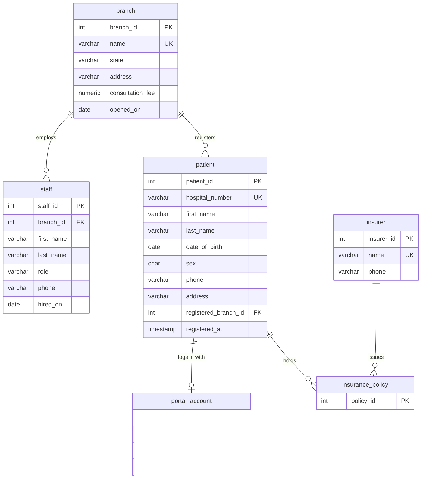
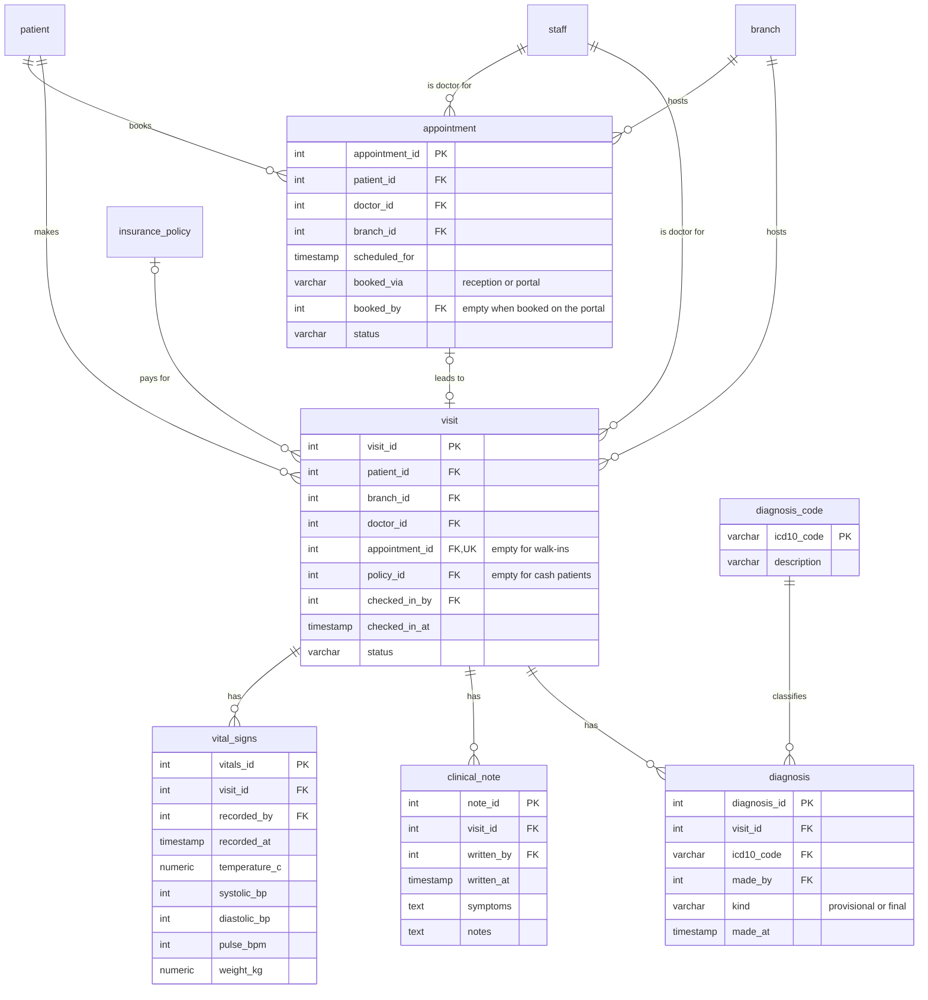
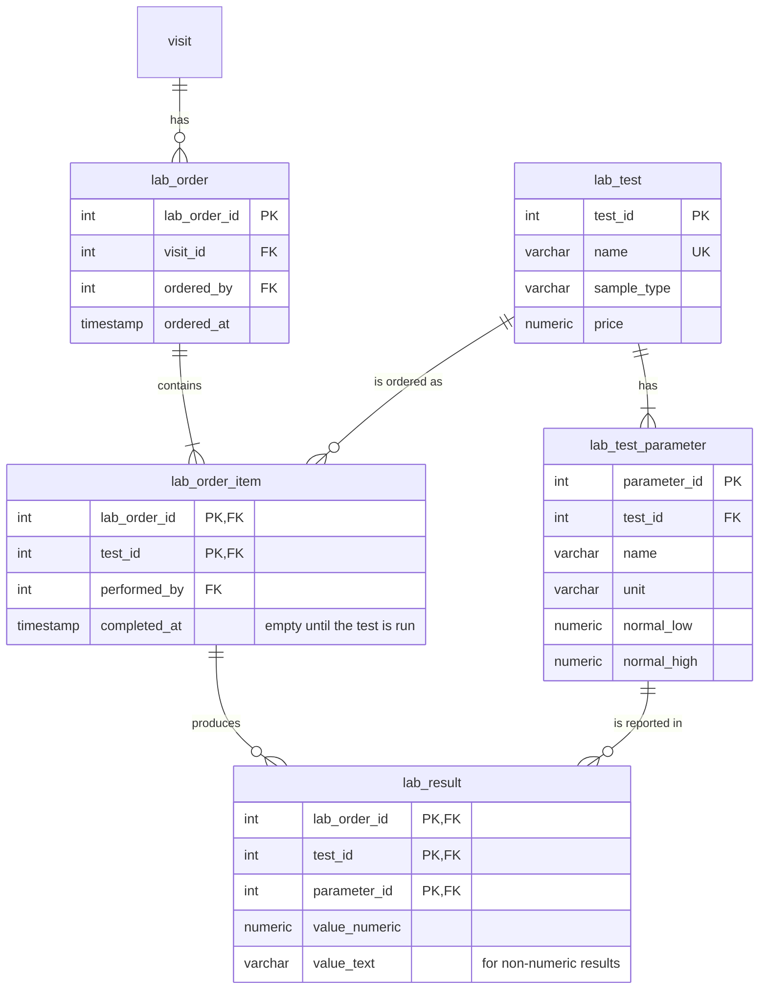
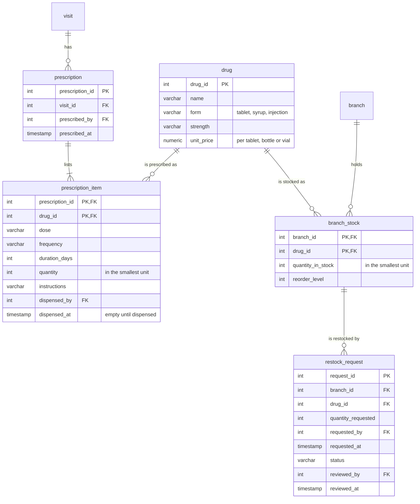
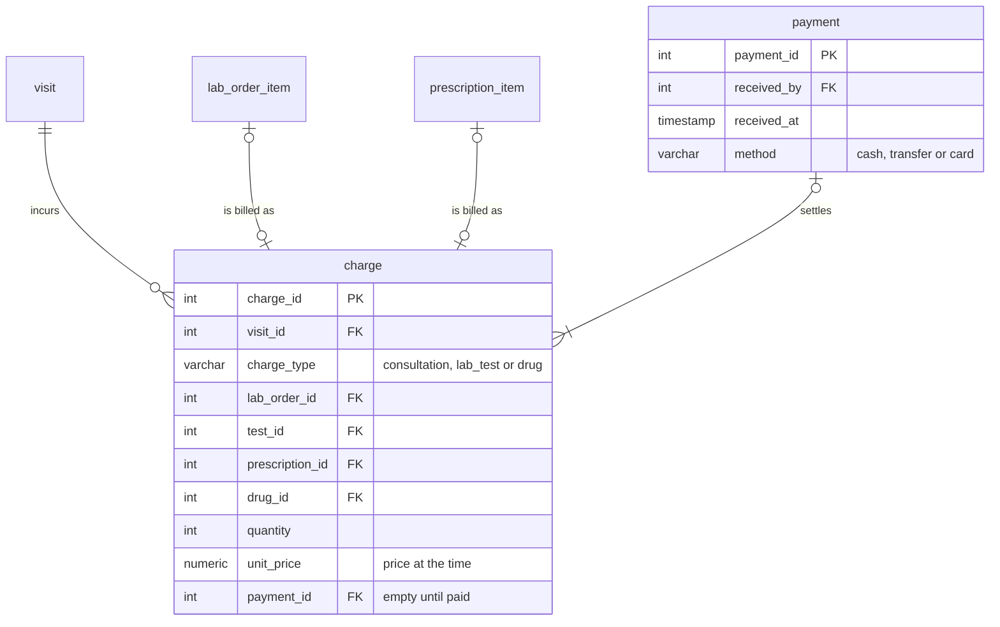

# Logical ER diagrams by area: Mermaid source

Source for the five `er-logical-*.png` images in the Portfolio 1 README. Render with `npx @mermaid-js/mermaid-cli -i er-logical-areas.md -o out.md`.

## 1. People and places

## 2. Visits and clinical care

## 3. Laboratory

## 4. Pharmacy and stock

## 5. Billing

